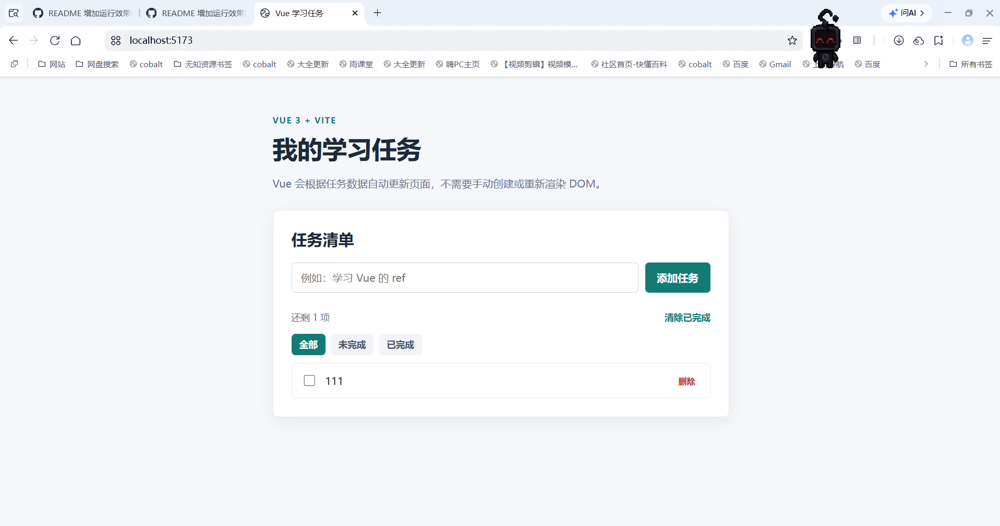

# Web 全栈学习仓库 📚

这里汇总了我从前端到后端的全部学习资料与实战 Demo，按学习阶段分为三大块。
> 说明：本仓库只收录**源码与笔记**，`node_modules`、`target`、`dist` 等依赖/构建产物已通过 `.gitignore` 忽略，不占用仓库体积。

## 🧭 学习路线总览

```
前端基础（HTML → CSS → JS → Vue 全家桶）
        ↓
后端与框架（SpringBoot + MySQL + MyBatis/JPA/JWT）
        ↓
全栈实战项目（前后端联调、任务管理 NovaKB）
```

## 一、前端基础（`前端基础/`）

| 序号 | 主题 | 内容 |
|----|------|------|
| 01 | HTML | 个人主页 Demo + 学习笔记 |
| 02 | CSS  | 登录页 Demo + 学习资料 |
| 03 | JavaScript | TodoList Demo + 学习资料 |
| 04 | JavaScript Fetch | Fetch Demo + 学习资料 |
| 05 | Vue 基础 | TodoList Demo + 学习资料 + 重点讲解 |
| 06 | Vue Router | Router Demo + 学习资料 |
| 07 | Vue Pinia | Pinia Demo + 学习资料 |
| 08 | Vue Axios | Axios Demo + 学习资料 |
| 09 | Element Plus | 后台 Demo + 学习资料 |

## 二、后端与框架（`后端与框架/`）

| 序号 | 主题 | 内容 |
|----|------|------|
| 10 | SpringBoot CRUD | 内存 CRUD Demo + 总结 + 资料 |
| 11 | MySQL | 建库建表 Demo + 学习资料 |
| 12 | SpringBoot + JPA + MySQL | JPA Demo + 学习资料 |
| 13 | SpringBoot + MyBatis | MyBatis Demo + 学习资料 |
| 14 | SpringBoot + JWT | JWT Demo + 学习资料 |

## 三、全栈实战项目（`全栈实战项目/`）

| 序号 | 主题 | 内容 |
|----|------|------|
| 15 | Java 基础复习 | 面向对象与集合 |
| 16 | Vue + JWT 前后端联调 | 联调学习资料 |
| 17 | 任务持久化 | 学习资料 |
| 18 | 新增任务与输入校验 | 学习资料 |
| 19 | 项目全貌与修改删除 | 图解讲义（docx/html/pdf） |
| 20 | 异常处理与错误反馈 | 图解讲义 + 配图 |
| 21 | Vue 从后端加载任务 | 图解讲义（html/pdf） |
| 22 | Vue 新建任务接入后端 | 图解讲义（html/pdf） |
| 23 | 后端修改状态与删除 | 图解讲义（html/pdf） |
| —  | NovaKB 项目源码 | 完整前后端项目源码 |

## 四、学习计划

- `学习计划-20天全栈.md`：20 天全栈项目学习计划
- `学习计划-收尾6天进阶.md`：项目收尾 6 天 · 边做边学与后端进阶路线

## 🖼️ 运行效果截图

> 把每个 Demo 跑起来后的界面截图，按下面文件名放进 `screenshots/` 文件夹即可自动显示。
> 例如：浏览器打开 `01-HTML/Demo/index.html` 截图 → 保存为 `screenshots/01-html.png`。

| 序号 | 项目 | 截图 |
|----|------|------|
| 01 | HTML 个人主页 |  |
| 02 | CSS 登录页 |  |
| 03 | JavaScript TodoList |  |
| 05 | Vue TodoList |  |
| 06 | Vue Router |  |
| 07 | Vue Pinia |  |
| 08 | Vue Axios |  |
| 09 | Element Plus 后台 |  |
| ★ | NovaKB 全栈项目 |  |

> 未上传截图前，表格里只显示图片名（不影响其他内容）。需要哪张图就补哪张，不必一次凑齐。

## 🚀 如何运行 Demo

- **前端（Vue）**：进入对应 `Demo` 目录 → `npm install` → `npm run dev`
- **后端（SpringBoot）**：用 IDE 打开 `Demo` → 等待 Maven 下载依赖 → 运行主类 `Application`
- 依赖安装后会自动生成 `node_modules/` / `target/`，已被 `.gitignore` 忽略，无需提交。

---
📌 仓库由本地整理上传，持续更新中。
